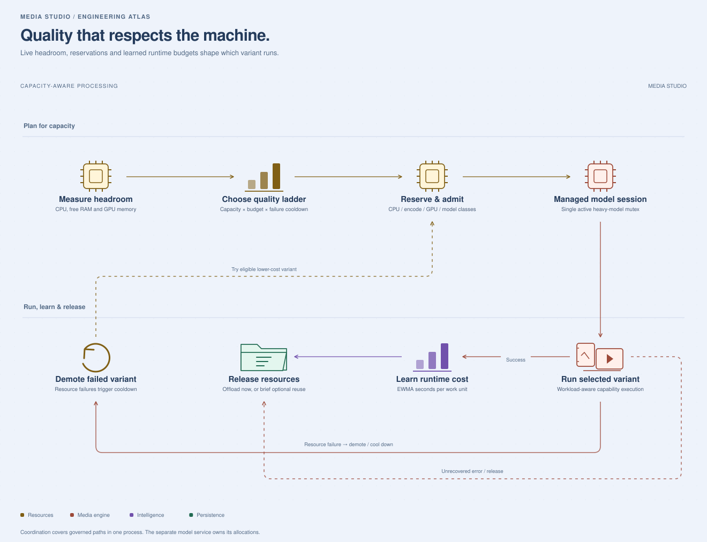

# What makes this project different

This project brings manual audio, video and image editing together with a local media copilot. Its most interesting engineering is how natural-language requests become constrained, inspectable media operations, and how optional AI processing shares a computer's limited resources.

The points below describe mechanisms visible in the source. They are not comparative benchmark claims or a claim that every optional engine has been tested on every platform. Start with the [system architecture](SYSTEM_ARCHITECTURE_OVERVIEW.md) for component boundaries and the [source inventory](ARCHITECTURE_SOURCE_MAP.md) for implementation coverage.

## Resource management is part of execution

| Engineering choice | Why it matters | Source |
|---|---|---|
| Resource-aware admission | CPU, encoding, GPU and model work have separate admission classes. Heavy operations can wait for capacity instead of all assuming the machine is idle. | [`job_scheduler.py`](../job_scheduler.py) |
| Concurrent reservations | Quality selection subtracts resources reserved by other in-flight jobs, reducing the risk of choosing variants against the same free-memory snapshot. | [`model_manager.py`](../model_manager.py) |
| Managed model lifecycle | Managed heavy models share a single active-model mutex and unload after use by default. Idle memory is an explicit policy rather than an accidental cache. | `ModelLifecycleManager` |
| Optional burst retention | A configurable short keepalive can reuse a model during repeated operations when headroom permits. This trades idle memory for fewer reloads. | `MEDIA_MODEL_KEEPALIVE_SEC` |
| Adaptive quality ladders | Capability-specific variants are selected under hardware and operator ceilings, with lower-cost fallbacks where implemented. | `AdaptiveQualityGovernor` |
| Failure cooldowns | A variant that fails under resource pressure is temporarily demoted, avoiding repeated attempts to run the same unsuitable configuration. | `AdaptiveQualityGovernor.plan()` / `run()` |
| Learned runtime budgets | An exponentially weighted moving average estimates seconds per work unit. Selection can skip variants predicted to exceed the capability's budget. | `record_runtime()` and timing helpers in `model_manager.py` |

These mechanisms coordinate governed paths inside one Python process. A separately hosted reasoning server owns its own model allocations. Actual memory peaks and latency still depend on codecs, media dimensions, model packs and hardware.

## Optimization across the pipeline

**Stream suitable audio operations.** Loudness metering, limiting, normalization and EQ use block-oriented processing paths in [`audio_processor.py`](../audio_processor.py). That matters for long recordings where keeping multiple full-track buffers resident is expensive. It does not imply that every audio operation or optional model is streaming.

**Avoid repeated video soundtrack work.** [`agent_processor.py`](../agent_processor.py) can group consecutive audio effects on video into one extraction/edit/remux chain. This reduces redundant work across compatible adjacent steps while preserving their plan lineage.

**Control native thread pools.** [`runtime_tuning.py`](../runtime_tuning.py) sets defaults before numeric libraries load and provides inference-session helpers. This addresses oversubscription when multiple numeric runtimes each create their own thread pools. Environment overrides remain available.

**Keep optional inference demand-driven.** The lifecycle manager and optional processor imports allow expensive capabilities to be loaded when needed. The default is prompt release of managed model memory; optional burst retention makes the reuse tradeoff configurable.

**Budget small-model context.** [`slm_context.py`](../slm_context.py), [`slm_profiles.py`](../slm_profiles.py) and [`slm_runtime.py`](../slm_runtime.py) select relevant tools, compact examples and prompt budgets. A confident local plan can avoid a reasoning request, while harder cases can use a configured model tier.

No speedup percentages, maximum supported file lengths or GPU-memory guarantees are published here without a reproducible measurement.

## Agentic workflows with constrained execution

The copilot has four specialist classes: Audio, Video, Vision and Inspector. They are execution roles within the application, with a registry of **31 named tools**. The reasoning model proposes structured actions; Python code determines whether those actions are valid.

1. **Understand the request.** Local intent parsing, explicit workflow invocations and optional model reasoning produce a candidate plan.
2. **Ground it in the media.** Inspection supplies real media type and properties. The planner validates supported tools, units, ranges, required parameters and media compatibility.
3. **Represent dependencies.** Each step can identify its input, main-chain role and branch behavior. A transcript or thumbnail can be a side artifact rather than replace the edited media.
4. **Execute under constraints.** The executor revalidates each step against its actual input and dispatches approved operations to specialist code. It does not execute arbitrary code supplied by the model.
5. **Check what came back.** File and media checks catch selected invalid outputs, including unreadable images and unexpectedly silent audio.
6. **Recover selectively.** Retries, explicit fallbacks and transcription enhancement retries handle supported failures. A failed dependency blocks its descendants while independent branches can continue.

The executor traverses the graph sequentially. Dependency-aware execution should not be advertised as parallel multi-agent execution. Long jobs use threads and HTTP polling, not SSE or a durable queue.

### An illustrative workflow

“Clean up this interview, normalize the level, and transcribe it” combines speech cleanup, loudness processing and transcript generation. The exact tool selection depends on the request and installed capabilities. A validated plan tracks which output feeds the next operation and which files are branch exports. If an upstream cleanup fails, downstream steps depending on that output are blocked instead of silently processing the wrong file.

See the [execution diagram](diagrams/execution-lifecycle.svg) and [copilot sequence](diagrams/copilot-sequence.svg).

## Manual editing and AI assistance share a workspace

| Area | Implemented functionality |
|---|---|
| Audio | Waveform regions, cutting, EQ, mixing, level/loudness operations, fades, conversion, transcription, speech cleanup and optional stems |
| Video | Upload/probe, clip timeline, speed and soundtrack controls, overlays, transformations, export, thumbnails, subtitles and optional scene detection, interpolation and matting |
| Image | Browser canvas transforms, adjustments, drawing/text and export; server-side cutouts, clarity, color matching, inpainting, restoration and upscaling |
| Unified studio | Shared media workspace, domain controllers, shortcuts, local project save/load and output reuse |
| Copilot | Natural-language plans, specialist dispatch, clarification, reusable workflows, optional memory and downloadable artifacts |

Some functions are editor endpoints rather than registered copilot tools. The [generated registry](ARCHITECTURE_SOURCE_MAP.md#copilot-tool-registry) is the authoritative list of chat-dispatchable tools.

## Persistent context without a hosted memory service

[`agent_memory.py`](../agent_memory.py) combines SQLite FTS5, vector retrieval and optional semantic embeddings. It can recall preferences and similar previous jobs, budget retrieved context and revalidate repeat plans for new media. Writes are queued through a background writer so memory collection does not have to block the synchronous chat response.

Memory is persistent personal data, not a temporary cache. Operators can disable it with `COPILOT_MEMORY=off`; memory APIs can delete stored records. Browser chat storage has a separate lifecycle. Local persistence reduces hosted dependencies but does not remove the need for deliberate deletion and access controls.

## Reusable workflows are an extension surface

Versioned [`skills/`](../skills/) workflows express reusable combinations of supported tools. Users can invoke workflows, save personal variants and import compatible instructions. Personal skill files are kept outside the versioned built-in catalog, and expanded plans still pass through validation.

To add a capability, treat its public contract and execution path as one change:

1. Implement the processor operation, input validation and output checks.
2. Add direct editor routing if required.
3. Add a `ToolSpec`, parameters, specialist dispatch and relevant local intent handling for copilot support.
4. Register optional quality variants and scheduler/resource behavior where appropriate.
5. Document model acquisition, licensing, fallback behavior and the capability's limits.
6. Regenerate the source inventory and update affected diagrams. Validate with generated, nonpersonal media in a temporary directory.

Adding a processor module alone does not make it available to the copilot.

## Offline operation has an explicit acquisition phase

Media and voice processing run on the application host. Optional inference packs can be acquired through [`download_models.py`](../download_models.py); voice packs require explicit flags. The reasoning endpoint is operator-configured and loopback-only. Local routing provides a fallback when that endpoint is unavailable.

Package installation and weight downloads can access external publishers. Some model sources use mutable upstream branches, and not every download has uniform checksum verification. Full supply-chain reproducibility remains follow-up work. Check [`THIRD_PARTY_NOTICES.md`](../THIRD_PARTY_NOTICES.md) for third-party components and review the license of each enabled pack; the repository's MIT license is not a blanket license for every dependency or model weight.

## Privacy is an engineering responsibility

- `.env` and its local variants, media, personal projects, memory, logs and model caches are excluded from version control.
- Model HTTP calls reject nonlocal endpoints and redirects and bypass configured HTTP proxies.
- Upload activity logging is disabled unless explicitly enabled. When enabled it collects filenames and client metadata.
- Repository checks flag prohibited artifacts and recognizable secret formats without printing matched values; optional history scanning checks locally reachable blobs.
- Architecture inventories are generated without importing the app, reading private runtime data or contacting models.

The current application remains a trusted single-user workspace. It does not provide built-in accounts or per-user isolation. See [privacy maintenance](REPOSITORY_PRIVACY.md) and the [review](CODEBASE_REVIEW.md).

## What contributors can improve next

The strongest next steps are connecting background progress/cancellation to execution, enforcing aggregate chunk-upload limits, bounding job retention, restoring synthetic regression coverage, standardizing model checksums and adding reproducible performance measurements. Shared hosting would additionally need authentication, ownership checks and durable job coordination.

These are specific engineering opportunities, not components already implemented. A useful benchmark contribution records the source revision, hardware, dependency and weight versions, input-generation recipe, selected quality tier, wall time, peak RAM/VRAM and output-quality measure.
