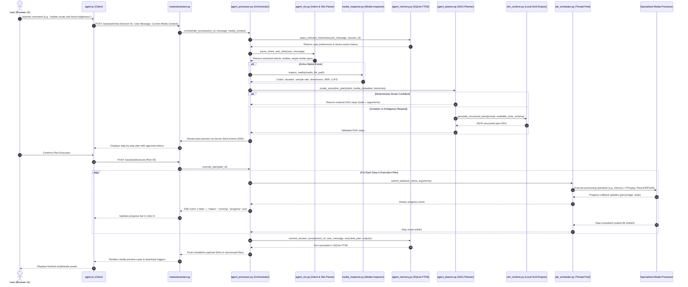
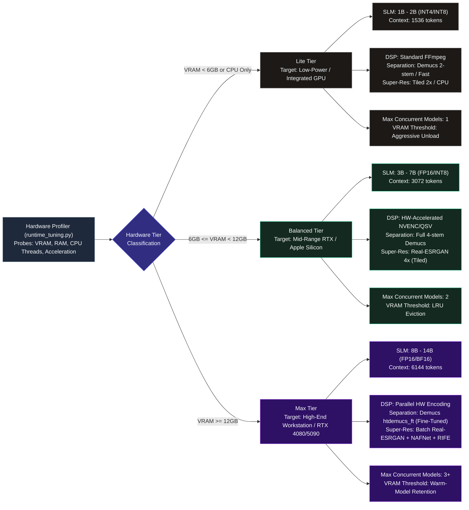

# Detailed End-to-End System & Component Architecture

This document provides a low-level, comprehensive architectural reference for the **Audio, Video & Image Studio** platform. It documents all 32 Python modules, 6 blueprint routes, 12 specialized media/neural processors, 9 client-side JavaScript controllers, hardware governance policies, memory schemas, and execution pipelines.

---

## 1. Complete End-to-End Component Architecture

```mermaid
flowchart TB
    %% ==========================================
    %% 1. CLIENT BROWSER TIER
    %% ==========================================
    subgraph Layer_Client ["Layer 1: Browser Presentation & Client Controllers"]
        subgraph Templates ["Jinja2 Templates"]
            T_Studio["studio.html\n(Unified Hub)"]
            T_Index["index.html\n(Audio Studio)"]
            T_Video["video.html\n(Video Editor)"]
            T_Image["image.html\n(Image Studio)"]
            T_Agent["agent.html\n(Copilot Chat)"]
            T_Landing["landing.html\n(Landing Page)"]
        end

        subgraph Client_Scripts ["Client-Side JavaScript Modules"]
            JS_Core["studio_core.js\nState Sync & Project Serialization"]
            JS_Audio["audio_studio.js & script.js\nWaveSurfer.js + Region Markers + AudioContext"]
            JS_Video["video_studio.js & video.js\nTimeline Slicer + WebGL Preview + Keyframing"]
            JS_Image["image_studio.js & image.js\nCanvas 2D/WebGL Filter Matrix + Transform Engine"]
            JS_Agent["agent.js & ai_agent.js\nSSE Stream Client + Plan Execution Stepper"]
            JS_Skills["agent_skills.js\nMacro Skill Runner & Parameter Dialogs"]
            JS_Voice["local_voice_input.js\nWeb Speech API / PCM Audio Capture"]
            JS_Overlay["processing_overlay.js\nTask Progress Modal & Job Cancel Handlers"]
            JS_Theme["theme.js & shortcuts.js\nCSS Variable Token Swapper & Global Keyboard Hooks"]
        end
    end

    %% ==========================================
    %% 2. APPLICATION GATEWAY & ROUTING
    %% ==========================================
    subgraph Layer_Gateway ["Layer 2: Application Gateway & Security (Flask 3.x)"]
        CoreApp["app.py\nFlask Application Factory & Middleware\nCORS Header Control & Static File Handlers"]
        Guard["identity_guard.py\nCSRF Token Validation & Path Traversal Guard\nHeader Sanitization & Session Verification"]
        Branding["branding.py\nRuntime Product & Assistant Name Normalizer"]

        subgraph Route_Blueprints ["Modular Route Blueprints"]
            BP_Audio["routes/audio.py\n/audio/cut\n/audio/split\n/audio/effects\n/audio/silence\n/audio/transcribe\n/audio/separate"]
            BP_Video["routes/video.py\n/video/render\n/video/trim\n/video/resize\n/video/filter\n/video/overlay_text\n/video/transitions"]
            BP_Image["routes/image.py\n/image/crop\n/image/rotate\n/image/adjust\n/image/resize\n/image/upscale\n/image/inpaint"]
            BP_Assistant["routes/assistant.py\n/assistant/chat\n/assistant/stream\n/assistant/plan\n/assistant/execute\n/assistant/memory"]
        end
    end

    %% ==========================================
    %% 3. COPILOT ORCHESTRATION & REASONING
    %% ==========================================
    subgraph Layer_Copilot ["Layer 3: Autonomous AI Copilot & Reasoning Subsystem"]
        Orchestrator["agent_processor.py (AgentOrchestrator)\nMulti-Turn Conversation Engine\nTool Dispatch & Step Verification\nSub-Agent Coordination Loop"]
        Planner["agent_planner.py (AgentPlanner)\nMulti-Step DAG Plan Generator\nDependency Validation & Param Resolver\nFallback & Self-Correction Engine"]
        NLU["agent_nlu.py (IntentRecognizer)\nSlot Extraction & Fuzzy Entity Matcher\nMedia Type Classifier & Fast Q&A KB"]
        Skills["agent_skills.py (SkillRegistry)\n43 Registered Composite Skills\nMacro Pipeline Recipes"]
        Inspector["media_inspector.py (MediaInspector)\nFFprobe Stream Introspection\nCodec, LUFS, SNR & Histogram Diagnostics"]
        
        subgraph SubAgents ["Specialized Sub-Agent Executors"]
            SA_Vision["VisionSubAgent\nImage QA & Object Detection"]
            SA_Video["VideoSubAgent\nScene Flow & Cut Detection"]
            SA_Audio["AudioSubAgent\nAcoustic & Loudness Profiler"]
            SA_Inspect["InspectorSubAgent\nQuality & Artefact Verifier"]
        end

        subgraph SLM_Subsystem ["Local SLM Loopback Reasoning"]
            SLM_Runtime["slm_runtime.py\nLoopback Client (http://127.0.0.1:8000/v1)\nStrict Non-Local Endpoint Rejection"]
            SLM_Context["slm_context.py\nToken Budget Calculation\nContext Compaction & Sliding Window"]
            SLM_Profiles["slm_profiles.py\nHardware Profiles: Gemma / Qwen / Llama / Phi"]
            Reasoning_Models["reasoning_models.py\nDynamic Tier Discovery (Lite / Balanced / Max)\nLatency-Aware Step-Down Fallback"]
        end

        subgraph Copilot_Memory ["Persistent Memory Subsystem"]
            Mem_Manager["agent_memory.py (AgentMemoryManager)\nSQLite FTS5 Full-Text Vector Engine\nEpisodic Log & Conversation Compaction"]
            DB_Memory[("data/copilot_memory/copilot_memory.db\nTables: sessions, messages, entities, facts")]
        end
    end

    %% ==========================================
    %% 4. MEDIA PROCESSING & NEURAL PIPELINES
    %% ==========================================
    subgraph Layer_Processors ["Layer 4: Media DSP & Neural Synthesis Pipelines"]
        subgraph Deterministic_Processors ["Deterministic Processing Core"]
            Proc_Audio["audio_processor.py\nFFmpeg DSP Engine + Librosa / SciPy\nNormalize, Fade, Parametric EQ, Pitch/Tempo"]
            Proc_Video["video_processor.py\nFFmpeg Multi-Stream Filter Graph\nConcat, Rescale, Transition Blends, Subtitle Burn"]
            Proc_Image["image_processor.py\nPillow + OpenCV Image Matrix Engine\nMatrix Transforms, Colorspace & Kernel Filtering"]
        end

        subgraph Neural_Processors ["Specialized Neural Network Processors"]
            Proc_Sep["separation_processor.py\nMeta Demucs v4 (htdemucs / mdx)\n4-Stem Isolation: Vocals, Bass, Drums, Other"]
            Proc_SR["realesrgan_processor.py\nReal-ESRGAN x4plus / Real-ESRGAN-anime\nPyTorch & ONNX Super-Resolution Tiling"]
            Proc_Deblur["nafnet_processor.py\nNAFNet Nonlinear Restoration\nImage Deblur & Video Denoising"]
            Proc_TTS["tts_processor.py\nEdge-TTS & Local Kokoro / Coqui\nMulti-Voice Timbre & Phoneme Timing Engine"]
            Proc_Face["codeformer_processor.py\nCodeFormer Blind Face Restoration\nFacial Landmark Fidelity Refinement"]
            Proc_Inpaint["lama_processor.py\nLaMa (Large Mask Inpainting)\nResolution-Robust Object Removal"]
            Proc_Matte["rvm_processor.py\nRobustVideoMatting (RVM)\nNeural Green-Screen Matting"]
            Proc_Interp["rife_processor.py\nRIFE Video Frame Interpolation\nMotion Vector Frame Doubling (60/120fps)"]
            Proc_Scene["transnetv2_processor.py\nTransNet V2 Shot Boundary Detection\nNeural Cut & Transition Timestamping"]
            Proc_Noise["deepfilter_processor.py\nDeepFilterNet Deep Audio Enhancement\nFullband Acoustic Noise Attenuation"]
        end
    end

    %% ==========================================
    %% 5. GOVERNANCE & RESOURCE MANAGEMENT
    %% ==========================================
    subgraph Layer_Governance ["Layer 5: Resource Governance & Infrastructure"]
        Governor["runtime_tuning.py (HardwareProfiler)\nCUDA, ROCm, Apple MPS, OpenVINO, CPU Core Detection\nVRAM & Host RAM Capacity Profiler"]
        ModelLifecycle["model_manager.py (ModelLifecycleManager)\nVRAM/RAM Budget Enforcement\nPyTorch CUDA Cache Management & LRU Eviction"]
        Scheduler["job_scheduler.py (JobScheduler)\nThreadPoolExecutor Task Dispatcher\nProgress Callbacks & Cancellation Tokens"]
        Downloader["download_models.py (ModelDownloader)\nChecksum-Validated Weights Downloader\nHugging Face & GitHub Releases Fetcher"]
        LogEngine["logger.py\nStructured File Logging with Rotation\nOptional PostgreSQL Upload Event Sink"]
    end

    %% ==========================================
    %% 6. PHYSICAL STORAGE & ASSET TIER
    %% ==========================================
    subgraph Layer_Storage ["Layer 6: Physical File Storage"]
        Dir_Uploads[("uploads/\nTemporary Ingest Assets")]
        Dir_Processed[("processed/\nRendered Exports & Stems")]
        Dir_Projects[("projects/\nProject State JSON")]
        Dir_Models[("models/\nPyTorch & ONNX Weights (.pth/.onnx)")]
        Dir_Logs[("logs/\nApplication Diagnostic Logs")]
    end

    %% ==========================================
    %% CONNECTIONS & DATA FLOWS
    %% ==========================================
    %% Client to Gateway
    Templates --> Client_Scripts
    Client_Scripts --> CoreApp
    CoreApp --> Guard
    Guard --> Route_Blueprints
    Branding -.-> CoreApp
    Branding -.-> Route_Blueprints

    %% Routes to Processors & Copilot
    BP_Audio --> Proc_Audio
    BP_Audio --> Proc_Sep
    BP_Audio --> Proc_Noise
    BP_Video --> Proc_Video
    BP_Video --> Proc_Interp
    BP_Video --> Proc_Scene
    BP_Image --> Proc_Image
    BP_Image --> Proc_SR
    BP_Image --> Proc_Deblur
    BP_Image --> Proc_Inpaint
    BP_Assistant --> Orchestrator

    %% Copilot Subsystem Wiring
    Orchestrator --> NLU
    Orchestrator --> Planner
    Orchestrator --> Inspector
    Orchestrator --> SubAgents
    Orchestrator <--> Mem_Manager
    Mem_Manager <--> DB_Memory
    Planner --> Skills
    Planner --> SLM_Runtime
    SLM_Runtime --> SLM_Context
    SLM_Context --> SLM_Profiles
    SLM_Runtime --> Reasoning_Models
    Planner -.->|Dispatches Tasks| Scheduler

    %% Governance & Resource Control
    Governor -.-> ModelLifecycle
    ModelLifecycle --> Neural_Processors
    Scheduler --> Layer_Processors
    Downloader --> Dir_Models
    CoreApp --> LogEngine

    %% Storage IO
    Deterministic_Processors <--> Dir_Uploads
    Deterministic_Processors --> Dir_Processed
    Neural_Processors <--> Dir_Uploads
    Neural_Processors --> Dir_Processed
    Neural_Processors <..> Dir_Models
    CoreApp <--> Dir_Projects
    LogEngine --> Dir_Logs

    %% Styling
    classDef clientStyle fill:#0f172a,stroke:#38bdf8,stroke-width:1px,color:#f8fafc;
    classDef gatewayStyle fill:#1e1b4b,stroke:#818cf8,stroke-width:1px,color:#f8fafc;
    classDef copilotStyle fill:#14291f,stroke:#10b981,stroke-width:1px,color:#f8fafc;
    classDef dspStyle fill:#1c1917,stroke:#f59e0b,stroke-width:1px,color:#f8fafc;
    classDef neuralStyle fill:#311027,stroke:#ec4899,stroke-width:1px,color:#f8fafc;
    classDef govStyle fill:#292524,stroke:#a8a29e,stroke-width:1px,color:#f8fafc;
    classDef storeStyle fill:#09090b,stroke:#64748b,stroke-width:1px,color:#f8fafc;

    class T_Studio,T_Index,T_Video,T_Image,T_Agent,T_Landing,JS_Core,JS_Audio,JS_Video,JS_Image,JS_Agent,JS_Skills,JS_Voice,JS_Overlay,JS_Theme clientStyle;
    class CoreApp,Guard,Branding,BP_Audio,BP_Video,BP_Image,BP_Assistant gatewayStyle;
    class Orchestrator,Planner,NLU,Skills,Inspector,SA_Vision,SA_Video,SA_Audio,SA_Inspect,SLM_Runtime,SLM_Context,SLM_Profiles,Reasoning_Models,Mem_Manager copilotStyle;
    class Proc_Audio,Proc_Video,Proc_Image dspStyle;
    class Proc_Sep,Proc_SR,Proc_Deblur,Proc_TTS,Proc_Face,Proc_Inpaint,Proc_Matte,Proc_Interp,Proc_Scene,Proc_Noise neuralStyle;
    class Governor,ModelLifecycle,Scheduler,Downloader,LogEngine govStyle;
    class DB_Memory,Dir_Uploads,Dir_Processed,Dir_Projects,Dir_Models,Dir_Logs storeStyle;
```

---

## 2. Copilot Planning & Execution Directed Acyclic Graph (DAG)



---

## 3. Hardware Tiering & Resource Governance Matrix

The **Adaptive Quality Governor** dynamically profiles the hardware runtime environment on boot and adjusts resource ceilings across three operating tiers:



---

## 4. Complete Tool Registry (43 Built-In Media Capabilities)

The planner dispatches operations across 43 specialized atomic tools categorized by media domain:

| Domain | Tool Identifier | Backing Processor | Functional Description |
|---|---|---|---|
| **Audio** | `audio_cut` | `audio_processor.py` | Trims audio between millisecond-precise timestamps |
| **Audio** | `audio_split` | `audio_processor.py` | Slices audio track into uniform segments or regions |
| **Audio** | `audio_normalize` | `audio_processor.py` | Normalizes perceived loudness to EBU R128 (-14 or -23 LUFS) |
| **Audio** | `audio_fade` | `audio_processor.py` | Injects linear, logarithmic, or exponential fade-in/out envelopes |
| **Audio** | `audio_speed` | `audio_processor.py` | Modifies tempo without altering pitch via WSOLA time-stretch |
| **Audio** | `audio_pitch` | `audio_processor.py` | Shifts musical pitch up/down by semitones while preserving tempo |
| **Audio** | `audio_equalizer` | `audio_processor.py` | Applies parametric 3-band, 5-band, or 10-band equalization |
| **Audio** | `audio_reverse` | `audio_processor.py` | Inverts PCM sample sequence for reverse audio effects |
| **Audio** | `audio_silence_detect` | `audio_processor.py` | Detects silence regions below decibel thresholds |
| **Audio** | `audio_strip_silence` | `audio_processor.py` | Truncates dead air and silence segments automatically |
| **Audio** | `audio_bpm_detect` | `audio_processor.py` | Detects tempo (BPM) and beat timestamps using onset detection |
| **Audio** | `audio_export` | `audio_processor.py` | Transcodes master track to MP3, WAV, FLAC, OGG, or AAC |
| **Separation** | `stem_separate_4stem` | `separation_processor.py` | Separates mix into vocals, drums, bass, and other |
| **Separation** | `stem_isolate_vocals` | `separation_processor.py` | Extracts isolated a cappella vocal track |
| **Separation** | `stem_remove_vocals` | `separation_processor.py` | Generates karaoke backing track with vocals removed |
| **Speech** | `speech_transcribe` | `audio_processor.py` | Generates timestamped transcripts using local Whisper models |
| **Speech** | `speech_denoise` | `deepfilter_processor.py` | Suppresses acoustic room noise and background hum |
| **Speech** | `tts_synthesize` | `tts_processor.py` | Synthesizes natural voiceover audio from text script |
| **Speech** | `tts_align_subtitles` | `tts_processor.py` | Generates synchronized SRT/VTT subtitle files for synthesized audio |
| **Video** | `video_trim` | `video_processor.py` | Trims video stream between start and end timestamps |
| **Video** | `video_cut` | `video_processor.py` | Cuts out unwanted segments and rejoins remaining stream |
| **Video** | `video_concat` | `video_processor.py` | Assembles multiple video clips into sequential timeline |
| **Video** | `video_speed` | `video_processor.py` | Changes video playback velocity with PTS timestamp scaling |
| **Video** | `video_resize` | `video_processor.py` | Scales resolution to preset aspect ratios (16:9, 9:16, 1:1, 4:3) |
| **Video** | `video_filter` | `video_processor.py` | Injects color grade curves: Sepia, B&W, Vivid, Cinematic, Cold |
| **Video** | `video_text_overlay` | `video_processor.py` | Burns styled typography onto video frames at 9 canvas anchor points |
| **Video** | `video_transitions` | `video_processor.py` | Renders dissolve, fade-to-black, wipe, and crossfade transitions |
| **Video** | `video_extract_audio` | `video_processor.py` | Demuxes audio stream directly to MP3 or lossless WAV |
| **Video** | `video_generate_gif` | `video_processor.py` | Converts video section to optimized color-paletted animated GIF |
| **Video** | `video_compress` | `video_processor.py` | Two-pass CRF transcode targeting specific file size ceilings |
| **Video** | `video_frame_extract` | `video_processor.py` | Grabs uncompressed single frame snapshot as high-res PNG |
| **Video** | `video_interpolate` | `rife_processor.py` | Neural frame interpolation doubling framerate to 60fps/120fps |
| **Video** | `video_scene_detect` | `transnetv2_processor.py` | Deep neural shot boundary detection for automated cut finding |
| **Video** | `video_matting` | `rvm_processor.py` | Neural background extraction without physical green screen |
| **Image** | `image_crop` | `image_processor.py` | Crops canvas to exact pixel boundaries or aspect ratios |
| **Image** | `image_rotate` | `image_processor.py` | Rotates bitmap by 90, 180, 270 degrees or custom angles |
| **Image** | `image_flip` | `image_processor.py` | Flips raster data horizontally or vertically |
| **Image** | `image_adjust` | `image_processor.py` | Adjusts brightness, contrast, saturation, and exposure levels |
| **Image** | `image_filters` | `image_processor.py` | Applies spatial matrix filters: blur, sharpen, edge enhance |
| **Image** | `image_compress` | `image_processor.py` | Compresses image buffer with WebP / MozJPEG quantization |
| **Image** | `image_upscale` | `realesrgan_processor.py` | Neural super-resolution spatial upscale (2x / 4x) |
| **Image** | `image_deblur` | `nafnet_processor.py` | Neural restoration eliminating camera shake and motion blur |
| **Image** | `image_face_restore` | `codeformer_processor.py` | Neural facial restoration enhancing eyes, teeth, and skin detail |
| **Image** | `image_inpaint` | `lama_processor.py` | Resolution-robust object and watermark removal |

---

## 5. Storage Hierarchy & State Invariants

```
project_root/
├── .env                          # Local private config (NEVER COMMITTED)
├── .env.example                  # Sanitized template for public cloning
├── app.py                        # Gateway initialization
├── branding.py                   # Centralized naming & label normalizer
├── identity_guard.py             # Security, CSRF & request validation
│
├── routes/                       # Modular REST & SSE endpoints
│   ├── __init__.py
│   ├── assistant.py              # Copilot endpoints
│   ├── audio.py                  # Audio studio endpoints
│   ├── image.py                  # Image studio endpoints
│   └── video.py                  # Video editor endpoints
│
├── static/                       # Client assets
│   ├── brand-mark.svg            # Vector product mark
│   ├── tokens.css                # Global design system CSS tokens
│   ├── agent.css / agent.js      # Copilot chat shell
│   ├── studio.css / studio.js    # Unified studio controller
│   ├── audio.css / audio.js      # Audio WaveSurfer engine
│   ├── video.css / video.js      # Video timeline engine
│   └── image.css / image.js      # Canvas matrix engine
│
├── data/
│   └── copilot_memory/           # SQLite episodic memory & vector tables
│       └── copilot_memory.db     # (Gitignored runtime state)
│
├── uploads/                      # Raw uploaded media (Gitignored)
├── processed/                    # Rendered output media (Gitignored)
├── projects/                     # Multi-clip timeline state JSON (Gitignored)
├── models/                       # Downloaded neural weights (Gitignored)
└── logs/                         # Rotating runtime execution logs (Gitignored)
```
