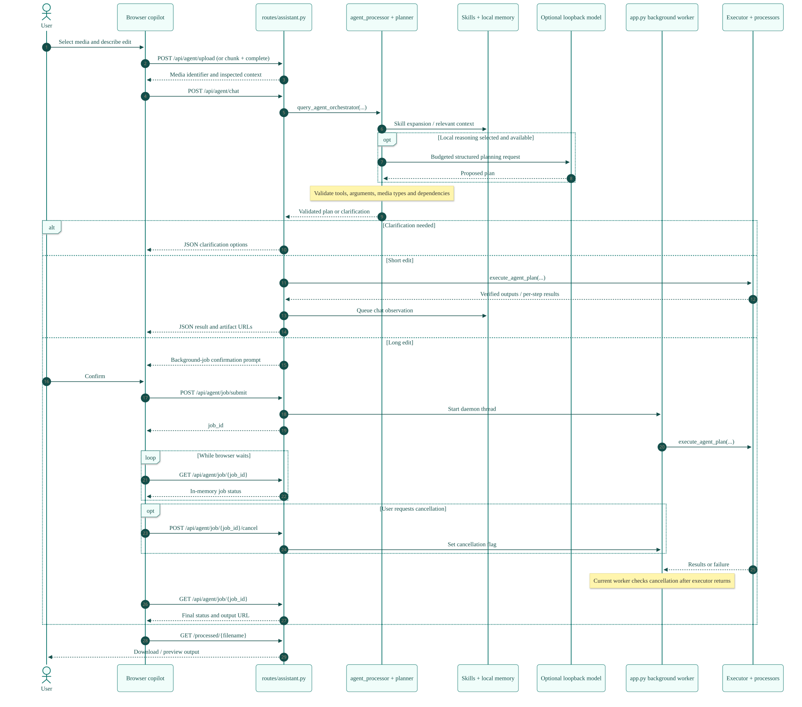

# Developer architecture

This reference follows the current source tree. Start with the [overview](SYSTEM_ARCHITECTURE_OVERVIEW.md); use the generated [source map](ARCHITECTURE_SOURCE_MAP.md) for complete module, route, tool, controller, template and skill inventories.

## Startup and application ownership

`app.py` imports `runtime_tuning` before numeric libraries so native thread defaults take effect early. It then loads `.env` before importing processors. Process environment values take precedence over `.env` values. A missing or recognized placeholder Flask secret produces an ephemeral cryptographic session key; configure a persistent random key for stable sessions across restarts.

The module creates local upload, processed and project directories, configures a 500 MiB per-request body limit, installs response/error guards and registers four blueprints through `routes/__init__.py`. It also owns shared path helpers, temporary cleanup, project saves and the background-job dictionary. Blueprints import helpers from `app.py`; this coupling explains the `__main__` module alias used by the launcher.

`identity_guard.py` controls assistant identity wording and scrubs responses. It is a presentation policy, not authentication, authorization, CSRF protection or a secret scanner. `branding.py` centralizes product and assistant display names.

## Browser and HTTP boundaries

| Surface | Main files | Server interface |
|---|---|---|
| Landing and navigation | `landing.html`, shared template partials, `theme.js` | `/`, `/studio`, `/audio`, `/video`, `/image`, `/agent`, `/chat` |
| Audio editor | `index.html`, `script.js`, WaveSurfer vendor files | `/cut`, `/audio/lufs`, `/audio/eq`, `/audio/multitrack-mix`, `/ai/*` |
| Video editor | `video.html`, `video.js` | `/video/upload`, `/video/quick`, `/video/export`, advanced `/video/*` |
| Image editor | `image.html`, `image.js` | Canvas edits in browser; server `/image/*` for advanced operations |
| Unified studio | `studio.html`, `static/js/studio_core.js`, domain studio controllers, `shortcuts.js` | Upload/media routes and `/studio/project/*` |
| Copilot | `agent.html`, `agent.js`, `agent_skills.js`, `static/js/ai_agent.js` | `/api/agent/chat`, `/api/agent/job/*`, skills and memory APIs |
| Voice input | `local_voice_input.js` | `/ai/transcribe` |
| Shared processing feedback | `processing_overlay.js` | Browser UI lifecycle |

HTTP contracts are JSON, multipart form uploads or media downloads. The complete declared route list is generated from decorators in the source map. Chunk uploads use `/api/agent/upload/chunk`, `/complete` and `/abort`; ordinary copilot upload uses `/api/agent/upload`. Uploaded files are stored under generated identifiers. Uploaded media is served by `/media/<media_id>`, thumbnails by `/video/thumb/<uid>/<n>`, and outputs by `/processed/<path:filename>`.

Browser chat sessions and pending imports use localStorage. Clearing server folders cannot clear these browser records. Browser-only image editing is possible, but neural enhancement and copilot operations send selected media to the application host.

## Copilot request sequence

The orchestrator is `query_agent_orchestrator()` in `agent_processor.py`. It expands selected workflows, prepares local intent and context, and uses `slm_runtime.PlanningSession` when applicable. If optional reasoning is unavailable, local intent routing remains available. `agent_planner.finalize_plan()` normalizes tools, checks parameters and media compatibility, and constructs input lineage and branch relationships.

The current long-operation decision is an explicit tool-name list in `routes/assistant.py`; it is not a scheduler-derived runtime estimate. `/api/agent/job/submit` accepts a filename, tool list and context, creates a daemon thread, and returns a `job_id`. The browser polls GET `/api/agent/job/<job_id>`. There is no `/assistant/execute` or tokenized plan-approval endpoint.

The synchronous chat route records memory observations and inspects results for follow-up suggestions. The background worker does not reproduce that entire chat postprocessing path. Its cancellation flag is checked after `execute_agent_plan()` returns; requesting cancellation does not currently interrupt that execution. A defined `_step_done()` callback is not wired into the executor, so background progress does not advance per step.

## Execution and failure semantics

`execute_agent_plan()` walks a dependency graph in a sequential loop. It resolves each step's source, inspects actual media, strictly revalidates arguments and dispatches to a sub-agent class. It is dependency-aware but does not parallelize independent branches.

- A failed step blocks dependent steps; independent branches can continue.
- Consecutive soundtrack edits on a video can be fused to avoid repeated extraction and remuxing.
- Output checks include file existence, image readability, unexpected audio silence and muted-video audio removal where applicable.
- Selected transient errors receive one retry; explicit fallback plans and quality demotion provide other recovery paths.
- Empty or low-confidence transcription can trigger a voice-enhancement retry.
- `final_output_of()` selects the main-chain artifact; `side_outputs_of()` exposes branch exports such as stems or transcript files.

The HTTP layer summarizes attempted failures as success, partial or failed. This is not a transactional job system: already written outputs are not rolled back after a later step fails.

## Media engine map

These are implementation families, not a guarantee that every optional dependency or weight file is present. Advanced HTTP operations and copilot tools have different coverage; consult the tool registry before exposing a processor as a chat capability.

| Module | Responsibility / engine family |
|---|---|
| `audio_processor.py` | Audio loading, streaming DSP, loudness/true-peak operations, EQ, mixing and export |
| `video_processor.py` | FFmpeg/ffprobe inspection, rendering, extraction, export, filters and video pipelines |
| `image_processor.py` | Pillow/OpenCV transforms, cutouts, clarity, color operations and optional neural routing |
| `ai_processor.py` | Silence/beat/VAD analysis, local transcription, denoise, optional DeepFilterNet speech enhancement and supporting workflows |
| `separation_processor.py` | Signal-processing fallback and optional Demucs stem separation |
| `realesrgan_processor.py` | Optional Real-ESRGAN super-resolution |
| `nafnet_processor.py` | Optional NAFNet deblurring / restoration |
| `codeformer_processor.py` | Optional CodeFormer face restoration |
| `lama_processor.py` | Optional LaMa inpainting |
| `rvm_processor.py` | Optional Robust Video Matting |
| `rife_processor.py` | Optional RIFE frame interpolation |
| `transnetv2_processor.py` | Optional TransNetV2 scene-boundary detection |
| `tts_processor.py` | Opt-in local Kokoro ONNX voice packs; OS speech / espeak process fallback |
| `media_inspector.py` | Media perception and quality measurements used in planning and verification |
| `download_models.py` | Optional model and voice-pack acquisition |

Whisper-family transcription belongs to speech recognition, not speech synthesis. Edge-TTS is not the documented voiceover implementation. Downloading models can require internet access; offline runtime requires the relevant packages and cached assets.

## Resource governance and reasoning

`job_scheduler.py` performs in-process admission for `model`, `gpu`, `cpu` and `encode` work classes, with resource estimates, queue deadlines and cooperative cancellation primitives. Processor calls using scheduler wrappers obtain admission before entering the managed model lock. It is not a durable external queue.

`ModelLifecycleManager` in `model_manager.py` serializes managed heavy model sessions and releases models after use by default. Optional `MEDIA_MODEL_KEEPALIVE_SEC` allows brief retention. The adaptive governor considers memory headroom, concurrent reservations, quality ceilings, failure cooldowns and learned runtime estimates. `lite`, `balanced` and `max` are selection ceilings; they do not mean one, two or three simultaneous models. Avoid documenting fixed GPU thresholds or fixed model sizes as universal guarantees.

`reasoning_models.py` discovers served model IDs, builds a capacity-aware tier ladder, retries supported structured-output modes and recovers from selected context-limit failures. `slm_profiles.py` holds model profiles, `slm_context.py` builds compact tool context and schemas, and `slm_runtime.py` chooses routing, budgets prompts and validates structured responses. Operators supply model identifiers; the system does not require a particular vendor model.

Model HTTP requests accept loopback IP literals or `localhost`, reject embedded credentials and query/fragment URLs, reject nonlocal redirects and bypass environment HTTP proxies. The local service receives prompt context and may receive memory text for embeddings. A separate model server's own GPU allocations are not controlled by the in-process lifecycle mutex.

## Memory, workflows and persistence

`agent_memory.py` uses `data/copilot_memory/memory.db` by default. SQLite tables include `memories`, `vectors` and schema `meta`; `memories_fts` supports FTS5 retrieval. The store combines lexical retrieval with vector similarity and optional on-device or loopback-service embeddings. It can retrieve preferences and similar successful jobs and revalidate repeat plans for current media. A single background writer queues observations. A custom memory location can be supplied through `COPILOT_MEMORY_PATH`.

`agent_skills.py` loads versioned `skills/*/SKILL.md`, ranks and expands workflows into tool plans, and manages personal skills in `user_skills/` or `COPILOT_USER_SKILLS_DIR`. The planner remains responsible for validation. These app workflows are distinct from the development assistant's installed skills.

| State | Persistence and lifecycle |
|---|---|
| Uploads / partial chunks | Private local files; age-based temporary cleanup |
| Outputs / transcripts / thumbnails | Private local files; saved-project references protect media from age cleanup |
| Projects | `.aviproject` JSON with edit state, file references and embedded generated image layers; atomic save |
| Copilot memory | Persistent local SQLite; memory APIs support deletion; disable with `COPILOT_MEMORY=off` |
| Personal skills | Persistent private Markdown workflows |
| Jobs | In-memory dictionary and daemon threads; lost on restart; no shared state across processes |
| Model handles | Process-local, governed lifecycle; downloaded weights remain on disk |
| Activity log | Opt-in CSV fallback or configured PostgreSQL; includes filenames, IPs and user agents |
| Browser state | localStorage, active document state and downloaded files; not covered by server cleanup |

The [storage guide](STORAGE.md) explains the one-hour eligibility and five-minute cleanup interval. Cleanup protects project references and defers deletion if a project cannot be read. It is not comprehensive privacy erasure.

## Trust boundaries and deployment constraints

The application is a trusted single-user tool. A session identifier selects conversation context; it is not an authenticated identity. No built-in user accounts, per-user project/media ownership or CSRF token enforcement is established by the identity response guard. Do not expose the service publicly based solely on the diagram's privacy claims.

Use a single application process while job state, scheduler admission and model locks remain in memory. An external worker queue, durable job store, authenticated users and per-user storage ownership are future architectural changes. They are not present components.

A 500 MiB request limit does not bound the total assembled size of a multi-request chunk upload. Chunk count and combined bytes need aggregate enforcement. Background admission, progress, cancellation and job retention also need further work before shared deployment. See the [review](CODEBASE_REVIEW.md) for prioritized findings.

## Architecture maintenance

The generated source map covers all first-party Python modules and scripts, all declared routes, all 31 copilot tools, first-party JavaScript, templates, built-in skill files and public configuration key names. External package versions and licensing remain in `requirements.txt` and `THIRD_PARTY_NOTICES.md`.

When changing an execution path, update its interactive definition in `docs/architecture/architecture.js`, export the matching SVG from the explorer, update the Mermaid reference and narrative, and regenerate the inventory. Review diagrams against handlers and call sites, not module names alone. Run source-map and repository-hygiene checks before publishing. See [diagram maintenance](diagrams/README.md).
