# System Architecture Overview

This document provides a high-level architectural overview of the **Audio, Video & Image Studio** open-source platform. It is designed for prospective users, developers, and open-source contributors who want to understand the foundational architecture and request lifecycles.

For an exhaustive, low-level component reference covering all internal classes, memory structures, and hardware adaptation pipelines, consult the [Detailed System Architecture](file:///docs/SYSTEM_ARCHITECTURE_DETAILED.md).

---

## Architectural Principles

1. **Strict Local Privacy**: Zero external cloud telemetry or third-party API dependencies. All computation, inference, and rendering occur entirely on the host machine.
2. **Hybrid Processing Topology**: Combines deterministic low-latency digital signal processing (FFmpeg, Librosa, OpenCV) with neural processing models (Demucs, Real-ESRGAN, NAFNet, Whisper, Edge-TTS).
3. **Decoupled Autonomous Copilot**: An intelligent workflow assistant operating via standard local loopback Large/Small Language Model (LLM/SLM) endpoints (vLLM, Ollama, LM Studio) or deterministic rule-based planning fallbacks.
4. **Adaptive Hardware Governance**: Dynamic model scaling and memory allocation responding in real time to available system RAM, VRAM, and CPU capabilities.

---

## High-Level System Architecture Diagram

```mermaid
flowchart TB
    %% ==========================================
    %% Open Source Architecture Overview
    %% ==========================================

    subgraph ClientTier ["Client Presentation Layer (Browser)"]
        UI_Audio["Audio Studio\n(WaveSurfer.js + Multi-track Canvas)"]
        UI_Video["Video Editor\n(Multi-clip Timeline + WebGL Canvas)"]
        UI_Image["Image Studio\n(Canvas Filter Engine + Transform Tools)"]
        UI_Agent["AI Copilot Interface\n(SSE Streaming + Natural Language Chat)"]
        UI_Core["Studio Core Hub\n(Theme Manager + Shortkey Dispatcher)"]
    end

    subgraph GatewayTier ["Application Gateway & Controller Layer (Flask 3.x)"]
        AppCore["Application Core (app.py)\nSecurity Guard, CORS, Session Context"]
        
        subgraph Blueprints ["Modular REST & Event Routing"]
            Route_Audio["Audio Blueprint (/audio)\nDSP, Stem Separation, Waveforms"]
            Route_Video["Video Blueprint (/video)\nTimeline Assembly, Filters, Transcode"]
            Route_Image["Image Blueprint (/image)\nColor, Crop, Neural Super-Resolution"]
            Route_Agent["Assistant Blueprint (/assistant)\nSSE Token Streaming, Execution Dispatch"]
        end
    end

    subgraph IntelligenceTier ["Autonomous AI Copilot Engine"]
        Orchestrator["Agent Orchestrator\n(Intent Routing & Session Lifecycle)"]
        NLU["Natural Language Unit (NLU)\n(Deterministic Slot & Intent Parser)"]
        Planner["Deterministic & Neural Planner\n(43-Tool Capability DAG Generator)"]
        Memory["Episodic & Vector Memory\n(SQLite FTS5 + Semantic Context)"]
        SLMClient["Local SLM / LLM Gateway\n(Loopback OpenAI-compatible Engine)"]
    end

    subgraph ExecutionTier ["Media Processing & Synthesis Pipelines"]
        subgraph DeterministicEngines ["Deterministic Processing Engines"]
            DSP_Audio["Audio DSP Pipeline\n(FFmpeg Engine + Librosa Analysis)"]
            DSP_Video["Video Composition Pipeline\n(FFmpeg Multi-Stream Filter Graph)"]
            DSP_Image["Image Transformation Pipeline\n(Pillow + OpenCV Core Engine)"]
        end

        subgraph NeuralEngines ["Specialized Neural Models"]
            NN_Sep["Stem Separation (Demucs v4)\nVocals, Drums, Bass, Other"]
            NN_SR["Super-Resolution (Real-ESRGAN)\nSpatial Upscaling & Restoration"]
            NN_Deblur["NAFNet Deblurring\nNonlinear Image/Video Restoration"]
            NN_TTS["Speech Synthesis & STT\n(Whisper ASR + Edge-TTS Engine)"]
        end
    end

    subgraph ResourceTier ["Resource Governance & Lifecycle"]
        Governor["Adaptive Quality Governor\n(Hardware Tiering: Lite / Balanced / Max)"]
        ModelManager["Model Lifecycle Manager\n(VRAM/RAM Caching & LRU Eviction)"]
        JobQueue["Asynchronous Job Scheduler\n(Worker Thread Pool & Task Cancellation)"]
    end

    subgraph StorageTier ["Host Storage & State Management"]
        FS_Uploads["Temporary Ingest Storage\n(/uploads)"]
        FS_Processed["Render & Export Storage\n(/processed)"]
        FS_Projects["Project State & Timelines\n(/projects)"]
        FS_Models["Neural Model Weights Cache\n(/models)"]
        FS_Memory["Agent Memory & Vector Stores\n(/data/copilot_memory)"]
    end

    %% Client to Gateway connections
    UI_Audio --> Route_Audio
    UI_Video --> Route_Video
    UI_Image --> Route_Image
    UI_Agent --> Route_Agent
    UI_Core -.-> AppCore
    AppCore --> Blueprints

    %% Gateway to Intelligence & Execution
    Route_Agent --> Orchestrator
    Route_Audio --> DSP_Audio
    Route_Audio --> NN_Sep
    Route_Video --> DSP_Video
    Route_Image --> DSP_Image
    Route_Image --> NN_SR

    %% Copilot Internal Flows
    Orchestrator --> NLU
    Orchestrator --> Planner
    Orchestrator <--> Memory
    Planner --> SLMClient
    Planner -.->|Dispatch Tools| ExecutionTier

    %% Governance & Execution
    Governor -.->|Hardware Policy| ExecutionTier
    Governor -.->|Model Quantization| ModelManager
    ModelManager --> NeuralEngines
    JobQueue --> ExecutionTier

    %% Storage connections
    ExecutionTier --> FS_Uploads
    ExecutionTier --> FS_Processed
    AppCore --> FS_Projects
    NeuralEngines --> FS_Models
    Memory --> FS_Memory

    %% Styling Definitions
    classDef clientStyle fill:#1e293b,stroke:#38bdf8,stroke-width:1px,color:#f8fafc;
    classDef gatewayStyle fill:#0f172a,stroke:#6366f1,stroke-width:1px,color:#f8fafc;
    classDef intelligenceStyle fill:#1e1b4b,stroke:#818cf8,stroke-width:1px,color:#f8fafc;
    classDef engineStyle fill:#14291f,stroke:#10b981,stroke-width:1px,color:#f8fafc;
    classDef resourceStyle fill:#2a1b18,stroke:#f59e0b,stroke-width:1px,color:#f8fafc;
    classDef storageStyle fill:#1e293b,stroke:#94a3b8,stroke-width:1px,color:#f8fafc;

    class UI_Audio,UI_Video,UI_Image,UI_Agent,UI_Core clientStyle;
    class AppCore,Route_Audio,Route_Video,Route_Image,Route_Agent gatewayStyle;
    class Orchestrator,NLU,Planner,Memory,SLMClient intelligenceStyle;
    class DSP_Audio,DSP_Video,DSP_Image,NN_Sep,NN_SR,NN_Deblur,NN_TTS engineStyle;
    class Governor,ModelManager,JobQueue resourceStyle;
    class FS_Uploads,FS_Processed,FS_Projects,FS_Models,FS_Memory storageStyle;
```

---

## Data & Request Flow Summary

### 1. Direct Interactive Editing Path
1. The user imports an asset in **Audio Studio**, **Video Editor**, or **Image Studio**.
2. Files are chunked and staged in `/uploads` through the application gateway.
3. Interactive manipulation (cropping, trimming, multi-region splitting, timeline positioning) is performed client-side using Web Audio and Canvas APIs.
4. Rendering requests invoke the corresponding Blueprint endpoint (`/audio`, `/video`, or `/image`).
5. Heavy transformations are executed either via the deterministic FFmpeg/OpenCV engines or scheduled via the neural pipeline (e.g. Demucs, Real-ESRGAN).
6. Outputs are compiled to `/processed` and streamed back for immediate preview and download.

### 2. Autonomous Copilot Path
1. The user issues a natural language request via the assistant shell.
2. The **NLU Unit** evaluates command structure, extracting parameters and target media assets.
3. The **Deterministic & Neural Planner** resolves dependencies, formulating a directed acyclic execution plan consisting of registered media tools.
4. If reasoning is enabled, the plan is synthesized via the local loopback **SLM Engine** while maintaining strict memory isolation.
5. The plan is executed sequentially with progress pushed real-time to the browser via Server-Sent Events (SSE).
6. State and interaction summaries are preserved in SQLite FTS5 for context continuity across editing sessions.
