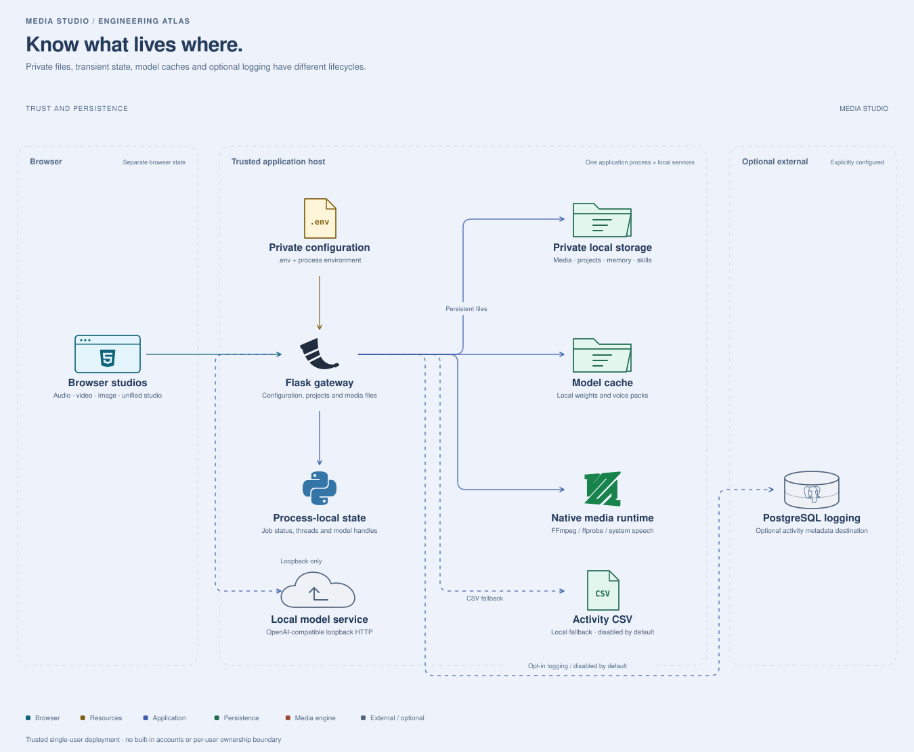

# System architecture

Audio, Video & Image Studio is a browser-based media editor backed by a single Python/Flask application. Editing uses local media processors; an optional, separately hosted loopback model service helps the copilot plan operations.

This document describes the implementation reviewed on 17 October 2026. The [source map](ARCHITECTURE_SOURCE_MAP.md) inventories every application Python module, declared HTTP route, copilot tool, browser controller, template and built-in skill. The [developer architecture](SYSTEM_ARCHITECTURE_DETAILED.md) explains execution and operational limits.

For an interactive tour, open the [architecture explorer](architecture/README.md). It provides six views with source-linked component details, connection tracing, guided steps, pan/zoom and theme-aware SVG export. The light theme is the default; dark is optional.

## System context



**Privacy boundary:** media processing runs on the application host. Copilot prompts and optional embedding requests are restricted to loopback services. Dependency installation and model acquisition can contact external publishers. PostgreSQL activity logging is optional and can send metadata to an operator-configured database. "Local" refers to the server computer; a browser accessing another computer uploads files to that computer.

## Application components



| Area | Responsibility | Implementation |
|---|---|---|
| Browser workspace | Waveform, timeline, canvas, playback, undo, chat and exports | `templates/`, first-party `static/*.js` and `static/js/` |
| Application gateway | Configuration, projects, media paths, background-job state, error and response guards | `app.py` |
| HTTP routing | Four blueprints for audio, video, image and assistant operations | `routes/` |
| Planning | Intent extraction, workflow expansion, optional model planning, argument and dependency validation | `agent_nlu.py`, `agent_skills.py`, `agent_planner.py`, `agent_processor.py` |
| Execution | Audio, Video, Vision and Inspector sub-agent classes; verified outputs and retries | `agent_processor.py` |
| Media engines | FFmpeg/DSP, image operations, transcription, separation, restoration and speech synthesis | Processor modules; see [engine map](SYSTEM_ARCHITECTURE_DETAILED.md#media-engine-map) |
| Resource governance | Admission slots, RAM/VRAM budgets, model lifecycle and quality selection | `job_scheduler.py`, `model_manager.py`, `runtime_tuning.py` |
| Persistent context | SQLite FTS5, vector retrieval, preferences and reusable personal workflows | `agent_memory.py`, `agent_skills.py` |

Solid arrows show requests or data flow. Dashed arrows identify optional dependencies or resource governance. The diagrams are logical views: the blueprints, planner, processors and scheduler run inside the same application process. Sub-agents are Python classes, not independently deployed services.

## End-to-end behavior

1. A user edits browser state or uploads media through an editor or the copilot. The server assigns file identifiers and inspects media when needed.
2. Direct editor requests call media processors. Copilot requests select skills or parse intent, consult optional memory, and may ask the loopback model for a structured plan.
3. The planner validates tool names, arguments, media types and dependencies. It can request clarification rather than execute an ambiguous edit.
4. Short plans execute within the request. Selected long AI operations prompt the user to submit a background job, whose status the browser polls over JSON HTTP.
5. The executor follows step dependencies, checks real input and output media, retries selected failures and returns the main result plus branch artifacts.
6. Results are previewed or downloaded from `/processed/`. Project saves persist edit state and references in `.aviproject` files; memory observations are queued asynchronously on the synchronous chat path.

There are **31 declared copilot tools**. Direct editor routes provide additional operations. There is no implemented SSE stream, external task broker, account system or distributed worker pool.

## Deployment and data boundaries



The default launcher binds Flask to loopback. Treat the application as a trusted, single-user workspace. It has no built-in user authentication or per-user file isolation. Network exposure requires an authenticated access boundary and deployment-specific protection; a reverse proxy alone does not add user isolation.

Background status and scheduling locks live in process memory. Restarting loses job status. Multiple independent WSGI processes do not share job dictionaries or model locks, so use one application process until those mechanisms are externalized. The separate reasoning server has its own model memory, outside the Python model-lifecycle mutex.

## Private storage and configuration

| Location | Contents | Repository policy |
|---|---|---|
| `.env` and environment variables | Session secret and local configuration | `.env` variants ignored; sanitized `.env.example` versioned |
| `uploads/`, `processed/` | Source media, chunks, outputs, thumbnails, transcripts | Ignored |
| `projects/` | Saved edit state, media references and embedded image layers | Ignored |
| `data/copilot_memory/memory.db` | Conversation observations, preferences and retrieval indexes | Ignored; disable with `COPILOT_MEMORY=off` |
| `user_skills/` | Personal reusable workflows | Ignored; configurable external location |
| `models/` | Downloaded neural weights and voice packs | Ignored |
| `logs/` or PostgreSQL | Optional filename and client activity metadata | Activity collection disabled by default |
| Browser storage | Chat sessions, drafts and pending imports | Outside Git and server cleanup |

Temporary cleanup is age-based and protects saved-project references. It does not erase conversation memory, browser storage, external databases, backups or remote Git copies. See [storage](STORAGE.md) and [repository privacy](REPOSITORY_PRIVACY.md).

## Maintain these diagrams

The interactive view definitions live in [`docs/architecture/`](architecture/README.md). Designed SVG exports and portable Mermaid references are in [`docs/diagrams/`](diagrams/README.md). SVGs render directly on GitHub and can be reused in presentations. Regenerate the source map after changing routes, tools or modules:

```powershell
python scripts/update_architecture.py
python scripts/update_architecture.py --check
python scripts/check_repository_hygiene.py --history
```

Read the [review findings](CODEBASE_REVIEW.md) for verified limitations and follow-up work. These diagrams describe the current implementation; they do not imply that all optional model packs have been installed or exercised.
